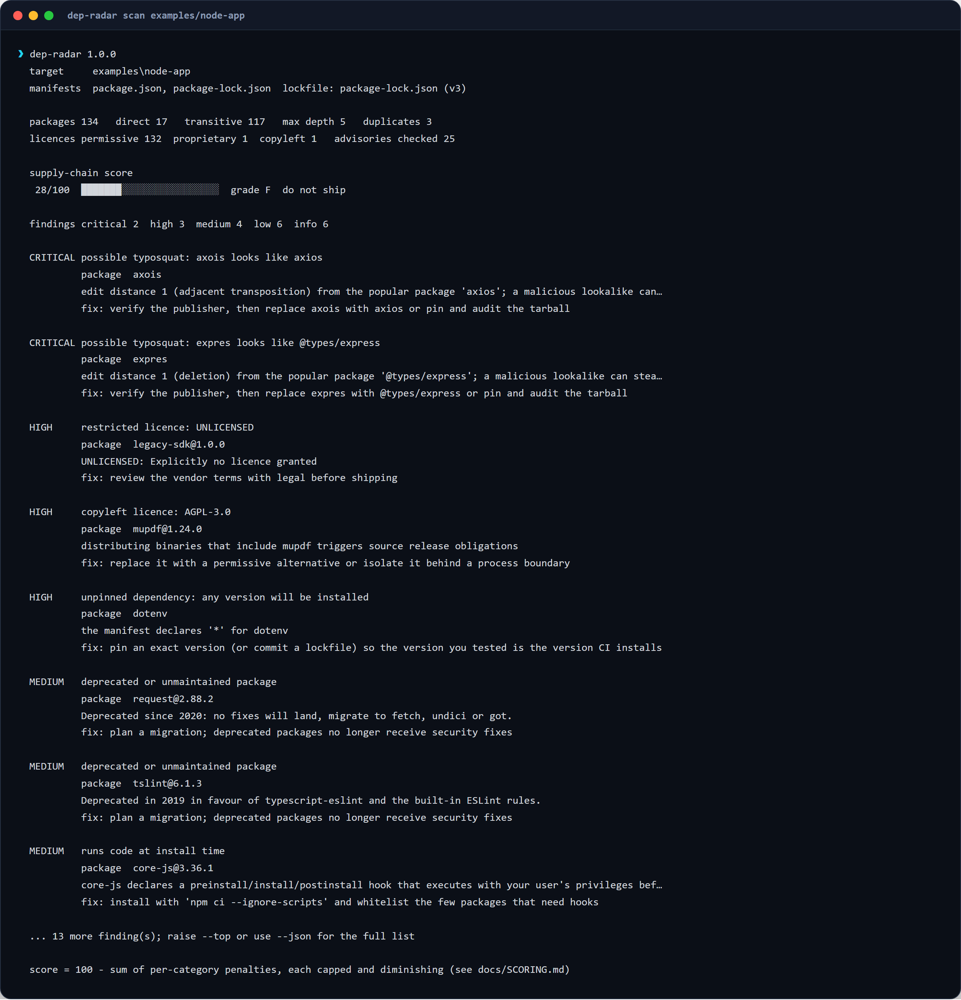
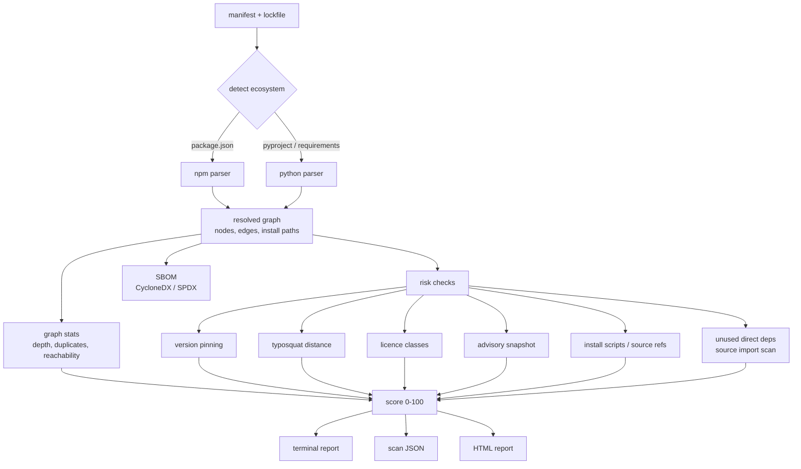

# dep-radar

**English** | [简体中文](README.zh-CN.md)

**Your dependency tree is a supply-chain attack surface. Audit it offline, in one command, before your install hooks run.**

[](https://github.com/kele-tao/dep-radar/actions/workflows/ci.yml)




`dep-radar` parses the manifests and lockfiles you already have, rebuilds the full
dependency graph - including duplicate copies at different depths - and reports the
things that actually get packages compromised: a name one keystroke away from a popular
package, a licence you cannot ship, a `postinstall` script that runs before you ever
import the code, a tarball URL that is not a registry, a direct dependency nothing imports.

No network. No npm install. No Python environment needed to scan a Node project.

---

## The problem

The average npm application pulls in a few hundred transitive packages, and nothing in
`package.json` tells you what is actually in that tree. Between 2021 and 2024 the
notable npm incidents - `ua-parser-js`, `coa`, `rc`, `node-ipc`, `event-stream` - were
not exotic zero-days. They were ordinary packages, installed by ordinary `npm install`
runs, executing install hooks with the developer's credentials. The same is true on
PyPI: a typo in `requirements.txt` (`reqeusts`) installs somebody else's package.

Existing tools either need network access to a commercial advisory feed, or they answer
a different question ("does this package have a CVE?") rather than the one you have at
review time ("what is in this tree, and which part of it is dangerous?"). `dep-radar`
runs in CI on the lockfile you already committed, in about a second for a 1000-package
tree.

## What it does

- **Parses real lockfiles offline.** `package.json` + `package-lock.json` v2/v3, yarn v1
  `yarn.lock`, `pyproject.toml` (PEP 621 **and** Poetry), `requirements.txt` with `-r`
  includes, extras, PEP 508 markers, hashes, editable installs and `poetry.lock`.
- **Rebuilds the graph, not just a list.** npm's hoisting rules are modelled, so
  `node_modules/a/node_modules/c@2` and `node_modules/c@1` are two distinct nodes with
  their own parents. Depth histogram, mean depth and duplicate versions fall out of it.
- **Scores the tree 0-100** with a documented, deterministic formula
  ([docs/SCORING.md](docs/SCORING.md)): per-category penalties with diminishing returns,
  so one systemic problem cannot zero the score while a critical typosquat still dominates.
- **Typosquat detection** by Damerau-Levenshtein distance <= 2 against a committed list of
  282 popular npm/PyPI packages, with a reviewed allowlist for genuine packages that happen
  to sit close to another name.
- **Licence risk** from an offline SPDX-ish table (56 identifiers, six risk classes),
  including correct `OR`/`AND` expression handling.
- **Install-script, git, tarball and deprecated-package flags** from the lockfile itself.
- **`explain <pkg>`** - the "why is this in my tree" answer, as concrete paths from the
  project root.
- **SBOM export** - CycloneDX-like and SPDX-like JSON with Package URLs, hashes from the
  lockfile's `integrity` field, and a `--validate` mode for the documented schema subset.
- **Machine-readable and human-readable** output: prioritised terminal report, stable
  `--json` schema, self-contained `--html` report, and `--fail-under` for CI gating.

## Install

Not on PyPI yet. Install from source; there are no runtime dependencies.

```bash
git clone https://github.com/kele-tao/dep-radar.git
cd dep-radar
pip install -e .          # gives you the 'dep-radar' command
python -m dep_radar --help  # the same CLI without installing
```

Python 3.10+ is required to *run* the tool. The projects it scans can be anything.

## Usage

### 1. Audit a project

```console
$ dep-radar scan examples/node-app
dep-radar 1.0.0
  target     examples/node-app
  manifests  package.json, package-lock.json  lockfile: package-lock.json (v3)

  packages 134   direct 17   transitive 117   max depth 5   duplicates 3
  licences permissive 132  proprietary 1  copyleft 1   advisories checked 25

  supply-chain score
   28/100  ███████░░░░░░░░░░░░░░░░░  grade F  do not ship

  findings critical 2  high 3  medium 4  low 6  info 6

  CRITICAL possible typosquat: axois looks like axios
           package  axois
           edit distance 1 (adjacent transposition) from the popular package 'axios'; a malicious lookalike can…
           fix: verify the publisher, then replace axois with axios or pin and audit the tarball

  CRITICAL possible typosquat: expres looks like @types/express
           package  expres
           edit distance 1 (deletion) from the popular package '@types/express'; a malicious lookalike can stea…
           fix: verify the publisher, then replace expres with @types/express or pin and audit the tarball

  HIGH     restricted licence: UNLICENSED
           package  legacy-sdk@1.0.0
           UNLICENSED: Explicitly no licence granted
           fix: review the vendor terms with legal before shipping

  HIGH     copyleft licence: AGPL-3.0
           package  mupdf@1.24.0
           distributing binaries that include mupdf triggers source release obligations
           fix: replace it with a permissive alternative or isolate it behind a process boundary

  ... 17 more finding(s); raise --top or use --json for the full list

  score = 100 - sum of per-category penalties, each capped and diminishing (see docs/SCORING.md)
```

The target is printed relative to your working directory when it is inside it, absolute
otherwise. The transcript above is a real run against the bundled example, which is why
the tree is deliberately poisoned.

### 2. Ask why a package is in the tree

```console
$ dep-radar explain accepts examples/node-app
dep-radar explain accepts
  tree: 134 packages, 17 direct

  accepts@1.3.8  (transitive dependency, ecosystem npm)
    licence: MIT
    depth:   1 from the project root
    pulled in by:
      <root> -> express@4.19.2 -> accepts@1.3.8
```

Duplicate copies are listed separately, each with its own paths. Same data as JSON with
`--json`:

```json
{
  "query": "lodash",
  "found": true,
  "matches": [
    {
      "key": "lodash@4.17.21",
      "name": "lodash",
      "version": "4.17.21",
      "ecosystem": "npm",
      "direct": true,
      "depth": 0,
      "paths": [["<root>", "lodash@4.17.21"]],
      "via": null,
      "parents": [],
      "license": "MIT",
      "source_kind": "registry"
    }
  ]
}
```

### 3. Export an SBOM and gate CI

```console
$ dep-radar sbom examples/py-app --format cyclonedx --validate
{
  "bomFormat": "CycloneDX",
  "specVersion": "1.5",
  "serialNumber": "urn:uuid:b863f486-9ea2-5439-83d7-e74417a5dccc",
  "version": 1,
  "metadata": {
    "timestamp": "2026-01-01T00:00:00Z",
    "tools": [{ "vendor": "dep-radar", "name": "dep-radar", "version": "1.0.0" }],
    "component": { "type": "application", "bom-ref": "pkg:pypi/py-app@root", "name": "py-app" }
  },
  "components": [
    {
      "type": "library",
      "bom-ref": "pkg:pypi/celery",
      "name": "celery",
      "purl": "pkg:pypi/celery",
      "scope": "required",
      "licenses": [{ "license": { "name": "NOASSERTION" } }]
    }
  ]
}
```

```bash
# fail the build when the tree drops below 70/100
dep-radar scan . --fail-under 70

# write the human report and keep the machine one for the job artefact
dep-radar scan . --html out/report.html --json > out/scan.json

# only the summary, no findings (for a cron job)
dep-radar scan . --quiet
```

### Exit codes

| Code | Meaning |
| ---: | --- |
| 0 | Scan completed and the score met `--fail-under` (or no gate was set) |
| 1 | Findings or the quality gate failed: score below `--fail-under`, or `explain` found nothing |
| 2 | Usage error: unknown arguments, missing path, unreadable or malformed manifest |

User errors never print a traceback: `dep-radar: error: <what went wrong>` plus a pointer
to `--help`.

## How it works



The parser layer is deliberately dumb: it only turns files into nodes and edges, and it
knows what it does not know. A lockfile entry with no `version`, a yarn range that cannot
be resolved, a requirements include that does not exist - each becomes a warning on the
report rather than a silent guess. That matters because every later stage trusts the graph.

The check layer is pure functions over that graph. Typosquat detection runs a banded
Damerau-Levenshtein distance with a length-bucket prefilter, so 1000 packages x 282 known
names costs about 700 ms rather than 60 seconds. Licence classification evaluates SPDX
expressions term by term: `MIT OR GPL-3.0` takes the permissive branch, `MIT AND GPL-3.0`
takes the copyleft one, because that is literally what those expressions mean.

Scoring is a separate, documented function ([docs/SCORING.md](docs/SCORING.md)) rather
than a magic constant in the report code, so you can argue with the formula in a PR.

## Design decisions

**1. Parse lockfiles, do not re-resolve them.** dep-radar never calls a registry. The
lockfile is the artefact that gets deployed, so it is the artefact worth auditing; a
resolver would report versions that differ from what CI installs, and would make the tool
network-dependent and non-deterministic. The cost: a project without a lockfile gets
weaker analysis (dep-radar says so in a warning on every such scan).

**2. Keep the advisory snapshot in the repository.** The `advisories.json` file is 25
hand-curated entries, committed to git and versioned. That makes scans reproducible and
the tool honest about its limits, but it is explicitly *not* a live CVE feed - see
[Comparison](#comparison) and [docs/ROADMAP.md](docs/ROADMAP.md). A stale data file that
you can see and diff beats a live feed you cannot reproduce.

**3. Zero runtime dependencies, stdlib only everywhere.** `tomllib` is stdlib from 3.11 but
dep-radar supports 3.10, so `src/dep_radar/toml_lite.py` implements the subset of TOML 1.0
that manifests and lockfiles use (tables, arrays of tables, dotted keys, basic/literal/
multi-line strings, integers, floats, booleans, arrays, inline tables). On 3.11+ the stdlib
reader is used; on 3.10 the bundled one is. `tests/test_toml_lite.py` drives both paths and
asserts they produce the same graph, so the 3.10 path is not a decorative branch. Adding
`tomli` would have been one line, but a supply-chain auditor whose install pulls another
package for a 60-line parse is a bad look - and the fallback is 247 tests green on a real
CPython 3.10.20, not just on a simulated one.
No `requests`, no `rich`, no `click`: a supply-chain auditor with a large dependency tree
would be its own worst demo, and the CLI surface is small enough that `argparse` is right.

## Performance

`python benchmarks/run.py` generates deterministic npm v3 lockfiles and measures the full
pipeline (parse, graph, all checks, terminal and JSON rendering). Median of 9 runs on
Windows 11, Python 3.12.10, AMD64 (16 cores), measured while several other builds shared
the machine - treat these as an upper bound, not a best case:

| Packages | Lockfile | Median (ms) | Min (ms) | Max (ms) | Max depth |
| ---: | ---: | ---: | ---: | ---: | ---: |
| 100 | 32.9 KB | 57.16 | 45.64 | 70.59 | 1 |
| 500 | 174.4 KB | 218.20 | 196.13 | 238.84 | 8 |
| 1000 | 349.0 KB | 490.66 | 427.05 | 551.12 | 16 |
| 2000 | 707.1 KB | 1378.06 | 1260.75 | 1655.06 | 33 |

Raw data: [benchmarks/results.json](benchmarks/results.json),
[benchmarks/RESULTS.md](benchmarks/RESULTS.md). A 1000-package tree scans in **0.49 s**
against the 2 s budget; time grows linearly with the number of packages (~0.5 ms per
package), not quadratically.

## Comparison

| | dep-radar | `npm audit` | `pip-audit` | Snyk / Socket |
| --- | --- | --- | --- | --- |
| Works offline | **yes** | no (registry advisory API) | no (PyPI + OSV API) | no |
| Node and Python in one tool | **yes** | Node only | Python only | yes |
| Dependency paths / `explain` | **yes, built in** | no | no | yes (paid tier) |
| Licence risk classification | **yes, offline table** | no | no | yes |
| Typosquat detection | **yes, edit distance** | no | no | yes (Socket) |
| Live CVE database | 25 curated entries | registry feed | OSV | full, commercial |
| Install-script risk | **yes** | no | n/a | yes |
| SBOM export | **yes, CycloneDX/SPDX-like** | no | no | yes |
| Runtime dependencies | **none** | npm itself | several | service |

The honest summary: `npm audit` and `pip-audit` have live advisory feeds and dep-radar does
not. Socket does deeper behavioural analysis. dep-radar's niche is the offline, deterministic,
cross-ecosystem review that runs on a committed lockfile in CI with no credentials.

## Roadmap

- Replace the committed advisory snapshot with an importable OSV/GHSA JSON bundle
  (`dep-radar db import`), keeping the offline, reproducible default.
- `pnpm-lock.yaml` and `uv.lock` / `Pipfile.lock` parsers.
- A `diff` command: compare two lockfiles and show newly added packages, new install
  scripts and score deltas between branches.
- Optional transitive CVE matching against a *user-supplied* SBOM or advisory file, so
  teams can use their own threat intel without network access at scan time.
- Signed scan output (in-toto-style attestation) for CI provenance.

See [docs/ROADMAP.md](docs/ROADMAP.md) for the detailed list of what was deliberately cut
from v1.0 and why.

## Contributing

Issues and PRs are welcome. Please read [CONTRIBUTING.md](CONTRIBUTING.md) first: it covers
the dev setup (`pip install -e ".[dev]"`), the quality bar (`ruff check .` and `pytest`)
and the rule that every new fixture under `examples/` must be generated by
`scripts/gen_examples.py` so it stays reproducible.

## License

MIT - see [LICENSE](LICENSE). Copyright (c) 2026 kele.
