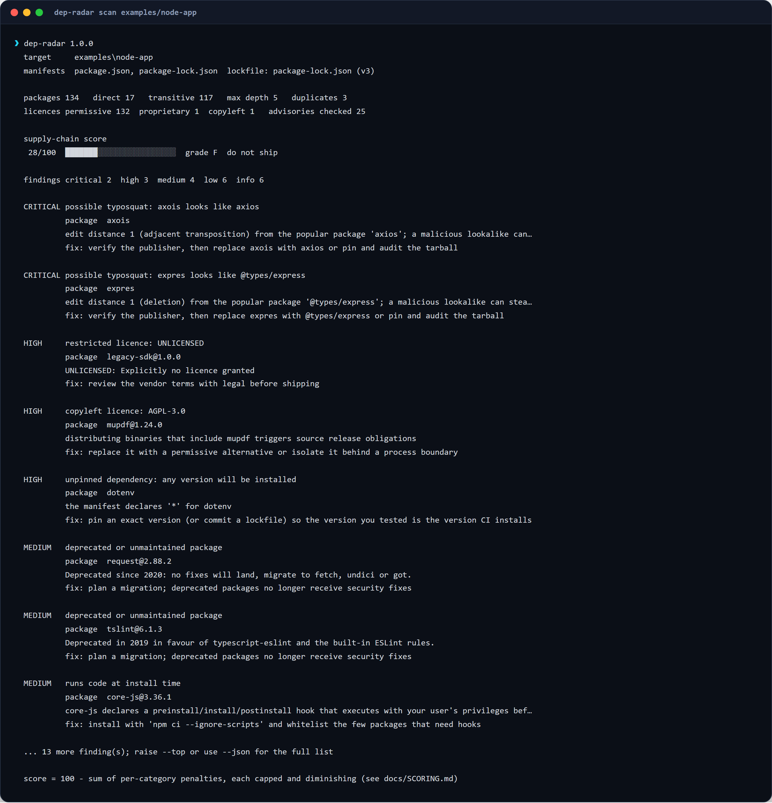
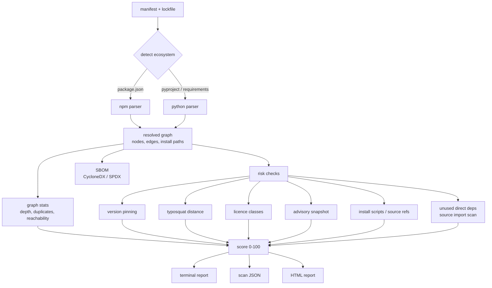

# dep-radar

[English](README.md) | **简体中文**

**你的依赖树就是一条供应链攻击面。用一条命令离线审计它，赶在安装钩子跑起来之前。**

[](https://github.com/kele-tao/dep-radar/actions/workflows/ci.yml)




`dep-radar` 读取你手上已经有的 manifest 和 lockfile，重建出完整的依赖图——包括同一个包
在不同深度上的多份副本——然后报告那些真正会让包被攻陷的问题：一个和流行包只差一次按键的
名字、一份你没法合法分发的许可证、一个在你 import 代码之前就已经执行的 `postinstall`
脚本、一个不在 registry 上的 tarball URL、一个没有任何源码 import 它的直接依赖。

不联网。不跑 `npm install`。扫描一个 Node 项目也不需要 Python 环境。

---

## 问题

一个普通的 npm 应用会拉进几百个传递依赖，而 `package.json` 里没有任何东西告诉你这棵树里
究竟有什么。2021 到 2024 年间那些有名的 npm 事件——`ua-parser-js`、`coa`、`rc`、
`node-ipc`、`event-stream`——都不是什么罕见的零日漏洞。它们就是普通包，被普通的
`npm install` 装上，然后用开发者的凭据执行安装钩子。PyPI 上也是一回事：`requirements.txt`
里打错一个字母（`reqeusts`），装上的就是别人的包。

现有工具要么需要联网去查商业漏洞情报源，要么回答的是另一个问题（“这个包有没有 CVE？”），
而不是你 review 时真正关心的那个问题（“这棵树里有什么，其中哪一部分是危险的？”）。
`dep-radar` 在 CI 里跑你已经提交的 lockfile，1000 个包的树大约一秒出结果。

## 它能做什么

- **离线解析真实的 lockfile。** `package.json` + `package-lock.json` v2/v3、yarn v1 的
  `yarn.lock`、`pyproject.toml`（PEP 621 **和** Poetry）、带 `-r` 引入、extras、
  PEP 508 环境标记、哈希、可编辑安装的 `requirements.txt`，以及 `poetry.lock`。
- **重建整张图，而不只是列一份清单。** npm 的 hoisting 规则被建模了，所以
  `node_modules/a/node_modules/c@2` 和 `node_modules/c@1` 是两个独立节点，各有各的父级。
  深度直方图、平均深度和重复版本都从这张图里直接得出。
- **给整棵树打 0-100 分**，用的是公开、确定性的公式（[docs/SCORING.md](docs/SCORING.md)）：
  按类别扣分并带收益递减，所以单个系统性问题不会把分数直接清零，而一个 critical 的仿冒包
  仍然能主导结果。
- **仿冒包检测**：对一份随仓库提交的、282 个常见 npm/PyPI 包名单做 Damerau-Levenshtein
  距离 <= 2 的比对，并为那些恰好和别的名字挨得很近的正规包维护了一份经过审阅的白名单。
- **许可证风险**来自一张离线 SPDX 风格的表（56 个标识符、六个风险等级），其中包括对
  `OR`/`AND` 表达式的正确处理。
- **安装脚本、git、tarball 和已废弃包的标记**，全部来自 lockfile 本身。
- **`explain <pkg>`**——回答“它为什么在我的树里”，给出从项目根出发的具体依赖路径。
- **SBOM 导出**——CycloneDX-like 与 SPDX-like JSON，带 Package URL、来自 lockfile
  `integrity` 字段的哈希，以及针对文档化 schema 子集的 `--validate` 模式。
- **机器可读 + 人类可读**两套输出：按优先级排序的终端报告、稳定的 `--json` schema、
  自包含的 `--html` 报告，以及用于 CI 门禁的 `--fail-under`。

## 安装

还没发布到 PyPI。请从源码安装；没有任何运行时依赖。

```bash
git clone https://github.com/kele-tao/dep-radar.git
cd dep-radar
pip install -e .          # gives you the 'dep-radar' command
python -m dep_radar --help  # the same CLI without installing
```

要*运行*这个工具需要 Python 3.10+。它扫描的项目是什么语言都无所谓。

## 用法

### 1. 审计一个项目

```console
$ dep-radar scan examples/node-app
dep-radar 1.0.0
  target     examples/node-app
  manifests  package.json, package-lock.json  lockfile: package-lock.json (v3)

  packages 134   direct 17   transitive 117   max depth 5   duplicates 3
  licences permissive 132  proprietary 1  copyleft 1   advisories checked 25

  supply-chain score
   28/100  ███████░░░░░░░░░░░░░░░░░  grade F  do not ship

  findings critical 2  high 3  medium 4  low 6  info 6

  CRITICAL possible typosquat: axois looks like axios
           package  axois
           edit distance 1 (adjacent transposition) from the popular package 'axios'; a malicious lookalike can…
           fix: verify the publisher, then replace axois with axios or pin and audit the tarball

  CRITICAL possible typosquat: expres looks like @types/express
           package  expres
           edit distance 1 (deletion) from the popular package '@types/express'; a malicious lookalike can stea…
           fix: verify the publisher, then replace expres with @types/express or pin and audit the tarball

  HIGH     restricted licence: UNLICENSED
           package  legacy-sdk@1.0.0
           UNLICENSED: Explicitly no licence granted
           fix: review the vendor terms with legal before shipping

  HIGH     copyleft licence: AGPL-3.0
           package  mupdf@1.24.0
           distributing binaries that include mupdf triggers source release obligations
           fix: replace it with a permissive alternative or isolate it behind a process boundary

  ... 17 more finding(s); raise --top or use --json for the full list

  score = 100 - sum of per-category penalties, each capped and diminishing (see docs/SCORING.md)
```

当目标就在当前工作目录之内时，它以相对路径打印；否则打印绝对路径。上面这段记录是对仓库里
自带的示例的真实运行结果——也正因如此，那棵树里是被故意“投毒”过的。

### 2. 查清某个包为什么会出现在依赖树里

```console
$ dep-radar explain accepts examples/node-app
dep-radar explain accepts
  tree: 134 packages, 17 direct

  accepts@1.3.8  (transitive dependency, ecosystem npm)
    licence: MIT
    depth:   1 from the project root
    pulled in by:
      <root> -> express@4.19.2 -> accepts@1.3.8
```

重复的副本会分别列出，各自带自己的路径。加 `--json` 可以得到同样的数据：

```json
{
  "query": "lodash",
  "found": true,
  "matches": [
    {
      "key": "lodash@4.17.21",
      "name": "lodash",
      "version": "4.17.21",
      "ecosystem": "npm",
      "direct": true,
      "depth": 0,
      "paths": [["<root>", "lodash@4.17.21"]],
      "via": null,
      "parents": [],
      "license": "MIT",
      "source_kind": "registry"
    }
  ]
}
```

### 3. 导出 SBOM，并在 CI 上设卡

```console
$ dep-radar sbom examples/py-app --format cyclonedx --validate
{
  "bomFormat": "CycloneDX",
  "specVersion": "1.5",
  "serialNumber": "urn:uuid:b863f486-9ea2-5439-83d7-e74417a5dccc",
  "version": 1,
  "metadata": {
    "timestamp": "2026-01-01T00:00:00Z",
    "tools": [{ "vendor": "dep-radar", "name": "dep-radar", "version": "1.0.0" }],
    "component": { "type": "application", "bom-ref": "pkg:pypi/py-app@root", "name": "py-app" }
  },
  "components": [
    {
      "type": "library",
      "bom-ref": "pkg:pypi/celery",
      "name": "celery",
      "purl": "pkg:pypi/celery",
      "scope": "required",
      "licenses": [{ "license": { "name": "NOASSERTION" } }]
    }
  ]
}
```

```bash
# fail the build when the tree drops below 70/100
dep-radar scan . --fail-under 70

# write the human report and keep the machine one for the job artefact
dep-radar scan . --html out/report.html --json > out/scan.json

# only the summary, no findings (for a cron job)
dep-radar scan . --quiet
```

### 退出码

| 退出码 | 含义 |
| ---: | --- |
| 0 | 扫描完成，且分数满足 `--fail-under`（或者根本没有设置门禁） |
| 1 | 发现了问题，或质量门禁未通过：分数低于 `--fail-under`，或者 `explain` 什么也没找到 |
| 2 | 用法错误：未知参数、路径不存在、manifest 不可读或格式不对 |

用户错误永远不会打印 traceback：只有一行 `dep-radar: error: <what went wrong>`，外加一个
指向 `--help` 的提示。

## 工作原理



解析器这一层是故意做“笨”的：它只负责把文件变成节点和边，并且清楚自己不知道什么。
一个没有 `version` 的 lockfile 条目、一个解析不出来的 yarn 版本范围、一个并不存在的
requirements 引入——每一样都会在报告里变成一条 warning，而不是被悄悄猜过去。这一点很重要，
因为后面每一个阶段都建立在这张图上。

检查层全部是作用在这张图上的纯函数。仿冒包检测跑的是带长度桶预过滤的分带
Damerau-Levenshtein 距离，所以 1000 个包 x 282 个已知名字的耗时大约是 700 ms，而不是
60 秒。许可证分类逐个词地求值 SPDX 表达式：`MIT OR GPL-3.0` 走宽松许可那一边，
`MIT AND GPL-3.0` 走 copyleft 那一边——因为这两个表达式字面上就是这个意思。

打分是一个独立的、有文档的函数（[docs/SCORING.md](docs/SCORING.md)），而不是散落在报告
代码里的魔法常数，所以你可以在 PR 里直接和这个公式辩论。

## 设计取舍

**1. 解析 lockfile，而不是重新解析依赖。** dep-radar 从不调用 registry。lockfile 才是真正
会被部署出去的那个产物，所以它才是值得审计的产物；一个 resolver 会报出和 CI 实际安装的
版本不一致的结果，还会让工具变成依赖网络、不可复现。代价是：没有 lockfile 的项目只能得到
更弱的分析（每一次这样的扫描，dep-radar 都会在警告里把这件事讲清楚）。

**2. 把漏洞情报快照放在仓库里。** `advisories.json` 是 25 条人工维护的条目，提交进 git 并
带版本。这让扫描可复现，也让工具对自己的边界保持诚实，但它明确地*不是*一个实时 CVE 源——
见[对比](#对比)和 [docs/ROADMAP.md](docs/ROADMAP.md)。一份你能看见、能 diff 的过期数据文件，
好过一份你无法复现的实时数据流。

**3. 零运行时依赖，全栈只用标准库。** `tomllib` 从 3.11 起才进标准库，而 dep-radar 要支持
3.10，所以 `src/dep_radar/toml_lite.py` 实现了 manifest 和 lockfile 会用到的那部分 TOML 1.0
（表、表数组、点号键、基本/字面量/多行字符串、整数、浮点数、布尔值、数组、内联表）。在 3.11+
上使用标准库的读取器，在 3.10 上使用自带的实现。`tests/test_toml_lite.py` 会同时驱动两条
路径，并断言它们产生的图完全一致，所以 3.10 那条路径不是摆设。加一个 `tomli` 本来只是一行
事，但一个供应链审计工具的安装过程为了 60 行解析代码去拉另一个包，实在太难看了——而且这套
回退是在真实的 CPython 3.10.20 上跑绿了 247 个测试，不只是模拟出来的。
不依赖 `requests`、不依赖 `rich`、不依赖 `click`：一个自己拖着巨大依赖树的供应链审计工具
会成为自己最糟糕的演示，而 CLI 的规模小到用 `argparse` 正好。

## 性能

`python benchmarks/run.py` 会生成确定性的 npm v3 lockfile，并测量整条流水线（解析、建图、
全部检查、终端与 JSON 渲染）。下面是 Windows 11、Python 3.12.10、AMD64（16 核）上 9 次运行
的中位数，测量时机器上还有别的构建任务在跑——请把它当作上界，而不是最好成绩：

| 包数量 | lockfile 大小 | 中位数 (ms) | 最小值 (ms) | 最大值 (ms) | 最大深度 |
| ---: | ---: | ---: | ---: | ---: | ---: |
| 100 | 32.9 KB | 57.16 | 45.64 | 70.59 | 1 |
| 500 | 174.4 KB | 218.20 | 196.13 | 238.84 | 8 |
| 1000 | 349.0 KB | 490.66 | 427.05 | 551.12 | 16 |
| 2000 | 707.1 KB | 1378.06 | 1260.75 | 1655.06 | 33 |

原始数据：[benchmarks/results.json](benchmarks/results.json)、
[benchmarks/RESULTS.md](benchmarks/RESULTS.md)。1000 个包的树扫描耗时 **0.49 s**，
而预算是 2 s；耗时随包数量线性增长（每个包约 0.5 ms），而不是二次增长。

## 对比

| | dep-radar | `npm audit` | `pip-audit` | Snyk / Socket |
| --- | --- | --- | --- | --- |
| 可离线运行 | **是** | 否（registry 漏洞 API） | 否（PyPI + OSV API） | 否 |
| 一个工具同时覆盖 Node 和 Python | **是** | 仅 Node | 仅 Python | 是 |
| 依赖路径 / `explain` | **是，内置** | 否 | 否 | 是（付费档） |
| 许可证风险分级 | **是，离线表** | 否 | 否 | 是 |
| 仿冒包检测 | **是，编辑距离** | 否 | 否 | 是（Socket） |
| 实时 CVE 数据库 | 25 条人工维护条目 | registry 数据流 | OSV | 完整，商业 |
| 安装脚本风险 | **是** | 否 | 不适用 | 是 |
| SBOM 导出 | **是，CycloneDX/SPDX-like** | 否 | 否 | 是 |
| 运行时依赖 | **无** | npm 本身 | 若干 | 服务 |

诚实地说：`npm audit` 和 `pip-audit` 有实时的漏洞数据源，dep-radar 没有。Socket 的行为分析
更深。dep-radar 的定位是那份离线、确定性、跨生态的 review：在 CI 里跑在已提交的 lockfile 上，
不需要任何凭据。

## 路线图

- 把提交进仓库的漏洞快照换成可导入的 OSV/GHSA JSON 包（`dep-radar db import`），同时保持
  离线、可复现的默认行为。
- `pnpm-lock.yaml` 以及 `uv.lock` / `Pipfile.lock` 解析器。
- 一个 `diff` 命令：比较两个 lockfile，展示新增的包、新增的安装脚本，以及分支之间的分数差异。
- 可选的传递依赖 CVE 匹配，对照*用户自己提供*的 SBOM 或漏洞文件，让团队在扫描时无需联网也能
  用上自己的威胁情报。
- 带签名的扫描输出（in-toto 风格证明），用于 CI 溯源。

v1.0 里刻意砍掉了哪些东西、为什么砍，完整清单见 [docs/ROADMAP.md](docs/ROADMAP.md)。

## 参与贡献

欢迎提 issue 和 PR。请先读一遍 [CONTRIBUTING.md](CONTRIBUTING.md)：里面写了开发环境怎么搭
（`pip install -e ".[dev]"`）、质量标准（`ruff check .` 和 `pytest`），以及一条硬规则——
`examples/` 下每个新 fixture 都必须由 `scripts/gen_examples.py` 生成，以保证可复现。

## 许可证

MIT，详见 [LICENSE](LICENSE)。Copyright (c) 2026 kele。
